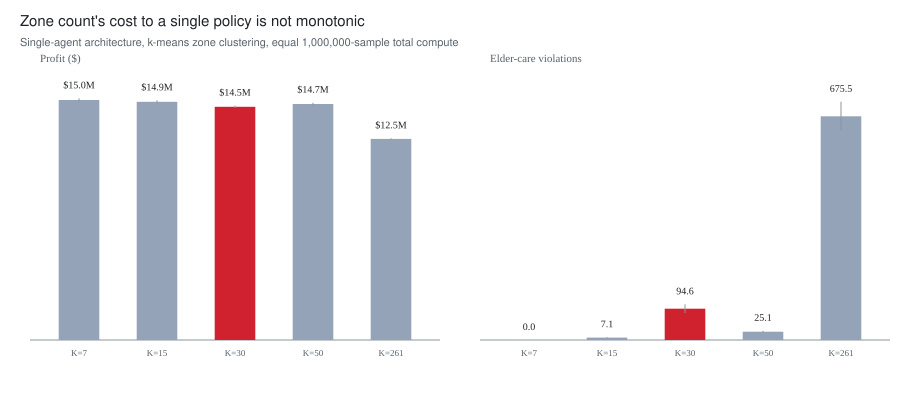
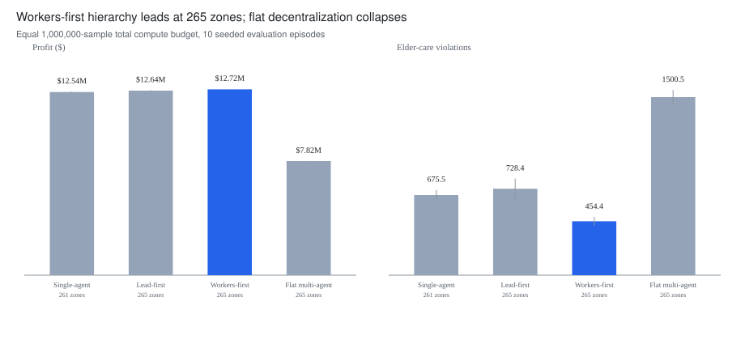

# Results

Equal-total-compute comparison results (every architecture trained on
1,000,000 environment-interaction samples total, evaluated over 10 seeded
episodes).

## Architectures compared

[`architectures_compared.csv`](architectures_compared.csv) -- all twelve
architecture/zone-count combinations (paper Section 5): zone count,
number of learners, whether policy weights are shared, and how
coordination across zones/agents is achieved (joint softmax, parameter
sharing, or alternating-best-response lead/worker training).

## Zone-count sweep (single-agent, K=15/30/50)

Table: [`zone_count_sweep.csv`](zone_count_sweep.csv). Source: [`single-agent-zone-sweep/`](../single-agent-zone-sweep).

## 265-zone architecture comparison

Table: [`265zone_architecture_comparison.csv`](265zone_architecture_comparison.csv). Sources:
[`single-agent/`](../single-agent) (265-zone config),
[`multi-agent-265zone/`](../multi-agent-265zone),
[`hierarchical-lead-first-265zone/`](../hierarchical-lead-first-265zone),
[`hierarchical-workers-first-265zone/`](../hierarchical-workers-first-265zone).

Each `*_mean` column in both CSVs is paired with a `*_std` column
(population std across the 10 evaluation episodes).
